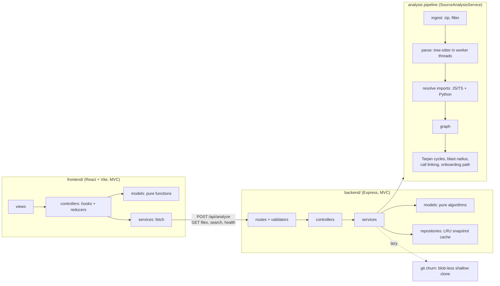

# Atlo architecture

## Request flow

1. `POST /api/analyze` downloads one zip, unzips it in memory with a pre-decompression filter.
2. Files are split into byte-balanced chunks and parsed in worker threads (inline below 40 files).
   Each worker owns its tree-sitter parsers and returns plain objects: imports, metrics, call sites.
3. Imports are resolved to real files (JS/TS resolver with tsconfig aliases, Python resolver with source-root detection).
4. The dependency graph is built, then the algorithms run over it.
5. The response holds the tree, graph (nodes, import edges, call edges, cycles) and the onboarding path.
   File text stays on the server and is fetched per file.
6. `GET /api/repos/:id/health` reads git history the first time the Hotspots tab or heat colouring is used, scores every file, and caches the report on the snapshot.

## Algorithms

| Algorithm | Where | Cost |
| --- | --- | --- |
| Circular imports: Tarjan strongly connected components (iterative) | `models/graphAlgorithms.js` | O(V + E) |
| Blast radius: bitset union over the condensed (circular-group) DAG | `models/graphAlgorithms.js` | O(E x V / 32) |
| Cyclomatic complexity: one cursor walk over the syntax tree | `services/parser/metricsExtractor.js` | O(N) in tree nodes |
| Call linking: name match in same file, then imported files | `models/callGraph.js` | O(calls x imports) |
| God file score: percentile rank of churn x complexity x (fanIn + fanOut) | `models/healthReport.js` | O(V log V) |
| Onboarding score and learning path | `models/onboarding.js` | O(V log V) |
